

# Our work

Web portals, dApps and websites designed, built and deployed by **thee AGENCY Consults (UG) Limited**. Tap a thumbnail to open the live project.

📄 **[Download the portfolio (PDF)](https://github.com/grahamaine/thee-agency-brand/raw/main/thee-AGENCY-Portfolio.pdf)** to share with clients.

<table>
<tr>
<td width="50%" valign="top">
<a href="https://6summits.vercel.app">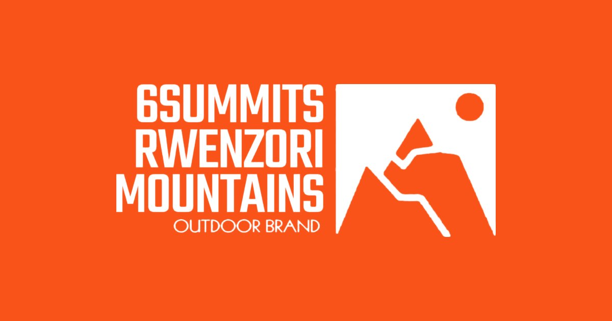</a> 
<b><a href="https://6summits.vercel.app">6 Summits Rwenzori</a></b> 
Client · Next.js · Supabase · AI agent 
Website, Google Business Profile and AI booking assistant for a Rwenzori trekking company. 
<a href="https://6summits.vercel.app">🌐 Live site</a> · 🔒 Private client code
</td>
<td width="50%" valign="top">
 
<b><a href="https://cord-dapp.vercel.app">Kakasa</a></b> 
Concordium · x402 · AI agents 
Accountable AI agents that pay supplier invoices, only to verified agents and within owner limits. 
<a href="https://cord-dapp.vercel.app">🌐 Live site</a> · <a href="https://github.com/grahamaine/cord-dapp">💻 Code</a>
</td>
</tr>
<tr>
<td width="50%" valign="top">
<a href="https://pamoja-solana.vercel.app">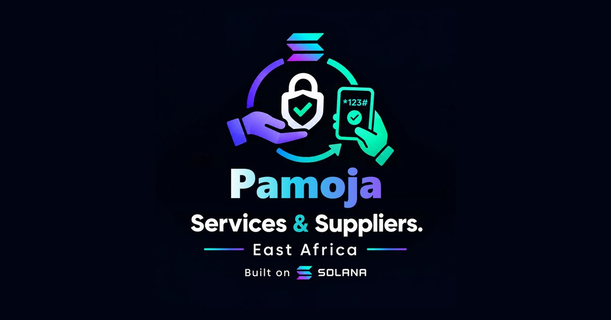</a> 
<b><a href="https://pamoja-solana.vercel.app">Pamoja</a></b> 
Solana · Escrow 
Pay when the service is done: escrow for local service businesses in Uganda. 
<a href="https://pamoja-solana.vercel.app">🌐 Live site</a> · <a href="https://github.com/grahamaine/Pamoja">💻 Code</a>
</td>
<td width="50%" valign="top">
<a href="https://kitepay.vercel.app">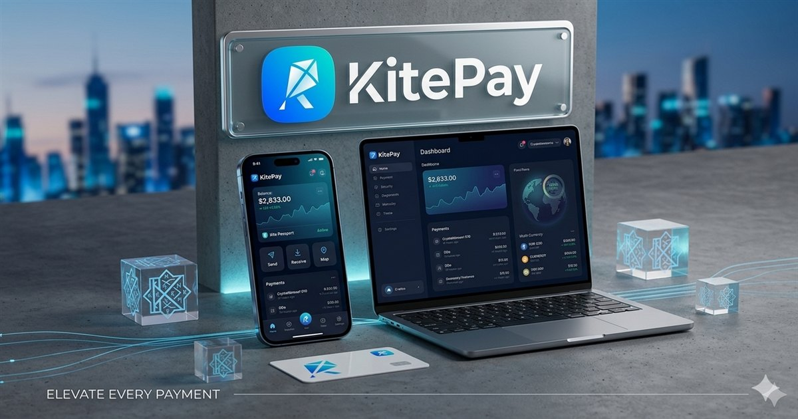</a> 
<b><a href="https://kitepay.vercel.app">KitePay</a></b> 
Kite Chain · Flutter · AI wallet 
Autonomous AI payment wallet built on Kite Chain for agentic commerce. 
<a href="https://kitepay.vercel.app">🌐 Live site</a> · <a href="https://github.com/grahamaine/KitePay_">💻 Code</a>
</td>
</tr>
<tr>
<td width="50%" valign="top">
<a href="https://unify-ux.vercel.app">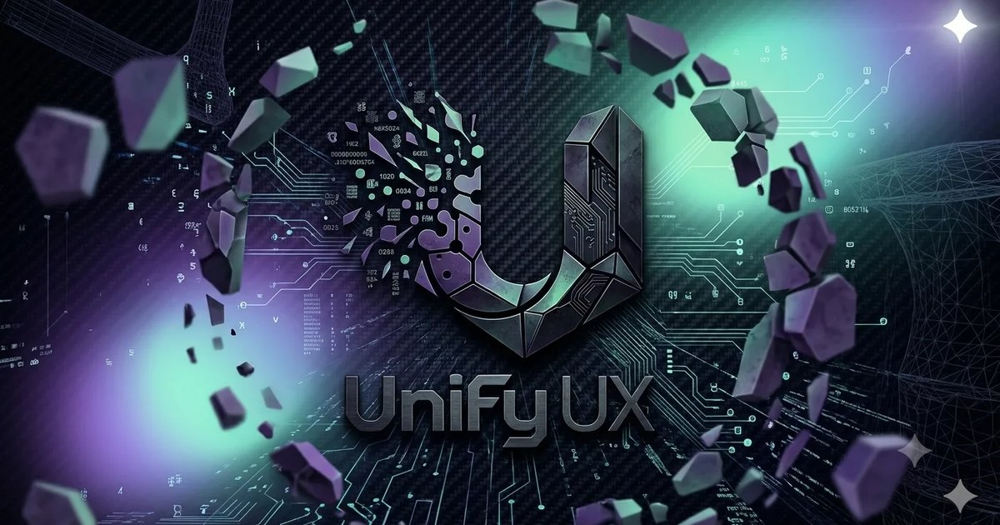</a> 
<b><a href="https://unify-ux.vercel.app">Universal Pay (Unify UX)</a></b> 
Particle · EIP-7702 · Arbitrum 
Pay or split with anyone, on any chain, in any token, from one balance. 
<a href="https://unify-ux.vercel.app">🌐 Live site</a> · <a href="https://github.com/grahamaine/universal-pay">💻 Code</a>
</td>
<td width="50%" valign="top">
<a href="https://arc-legacy-eight.vercel.app">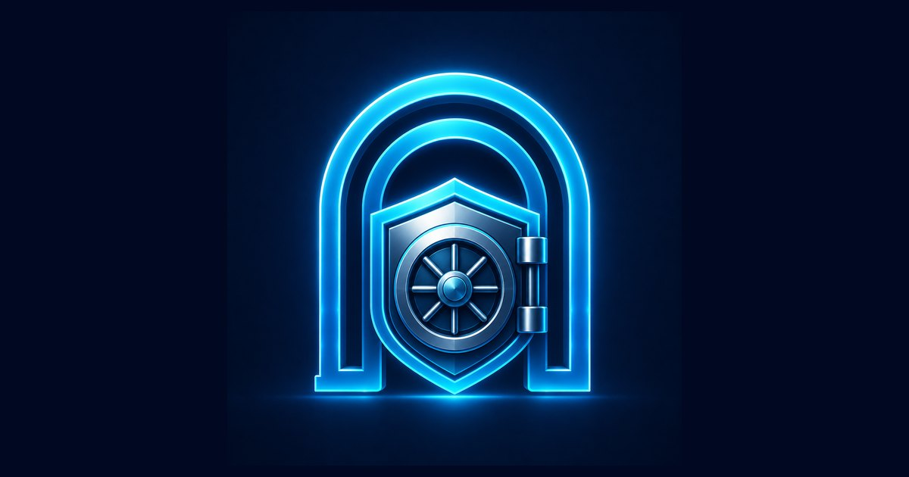</a> 
<b><a href="https://arc-legacy-eight.vercel.app">Arc Legacy</a></b> 
Arc · USDC · Autonomous agent 
On-chain estate planning where a USDC inheritance settles itself, plus recurring payments and yield. 
<a href="https://arc-legacy-eight.vercel.app">🌐 Live site</a> · <a href="https://github.com/grahamaine/arc-legacy">💻 Code</a>
</td>
</tr>
<tr>
<td width="50%" valign="top">
 
<b><a href="https://mezo-legacy-ainegb.vercel.app">Mezo Legacy</a></b> 
Bitcoin L2 · Mezo 
Gateway dApp to Mezo, the Bitcoin-native economic layer for earning on idle BTC. 
<a href="https://mezo-legacy-ainegb.vercel.app">🌐 Live site</a> · <a href="https://github.com/grahamaine/Mezo_Legacy">💻 Code</a>
</td>
<td width="50%" valign="top">
<a href="https://cantongun-dapp.vercel.app">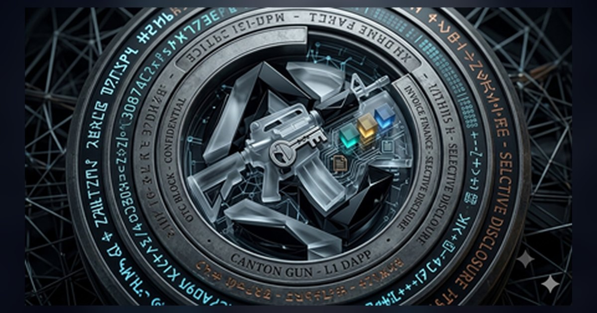</a> 
<b><a href="https://cantongun-dapp.vercel.app">Canton Gun</a></b> 
Canton Network · Privacy 
Confidential capital markets: private OTC block trading and invoice financing with selective disclosure. 
<a href="https://cantongun-dapp.vercel.app">🌐 Live site</a> · <a href="https://github.com/grahamaine/cantongun-dapp">💻 Code</a>
</td>
</tr>
<tr>
<td width="50%" valign="top">
<a href="https://aura-agentic.vercel.app">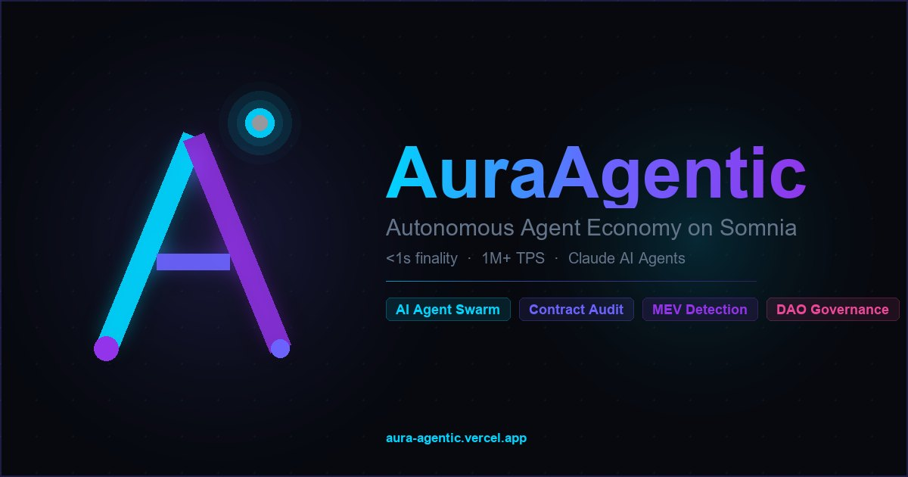</a> 
<b><a href="https://aura-agentic.vercel.app">AuraAgentic</a></b> 
Somnia · AI agents 
Agent-driven app on Somnia's agentic L1: AI agent swarm, contract audit, MEV detection. 
<a href="https://aura-agentic.vercel.app">🌐 Live site</a> · <a href="https://github.com/grahamaine/aura-agentic">💻 Code</a>
</td>
<td width="50%" valign="top">
<a href="https://moove-build.vercel.app">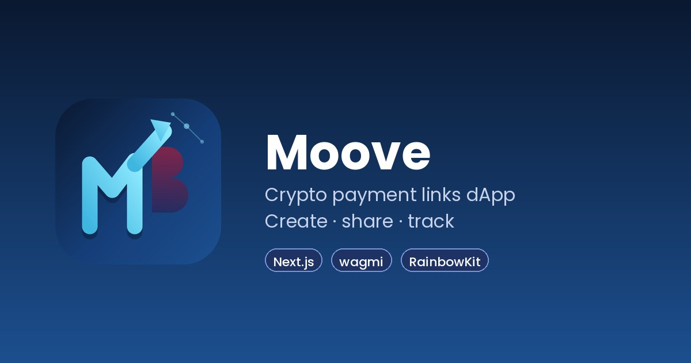</a> 
<b><a href="https://moove-build.vercel.app">Moove</a></b> 
Next.js · wagmi · RainbowKit 
Create and share crypto payment links, and track wallet balance and activity. 
<a href="https://moove-build.vercel.app">🌐 Live site</a> · <a href="https://github.com/grahamaine/moove-build">💻 Code</a>
</td>
</tr>
<tr>
<td width="50%" valign="top">
<a href="https://solana-dev-frontend.vercel.app">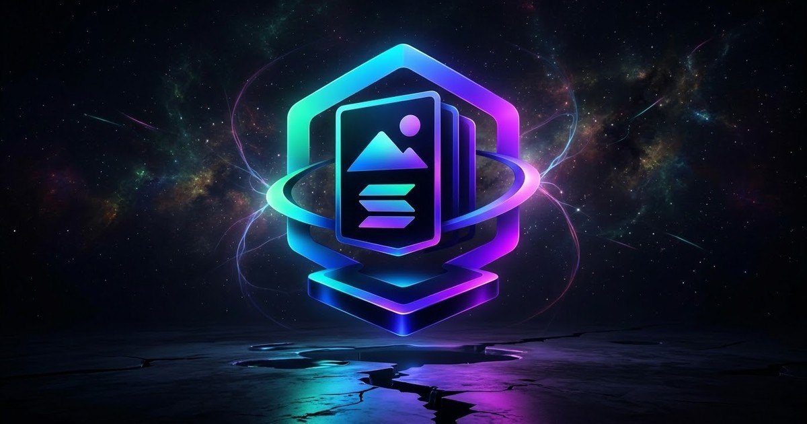</a> 
<b><a href="https://solana-dev-frontend.vercel.app">Solana Dev</a></b> 
Solana · Anchor · Rust 
Solana bootcamp workspace: escrow, tokens, NFTs, voting and DeFi programs, plus an NFT marketplace. 
<a href="https://solana-dev-frontend.vercel.app">🌐 Live site</a> · <a href="https://github.com/grahamaine/solana-dev">💻 Code</a>
</td>
<td width="50%" valign="top">
<a href="https://github.com/grahamaine/ChainLinks">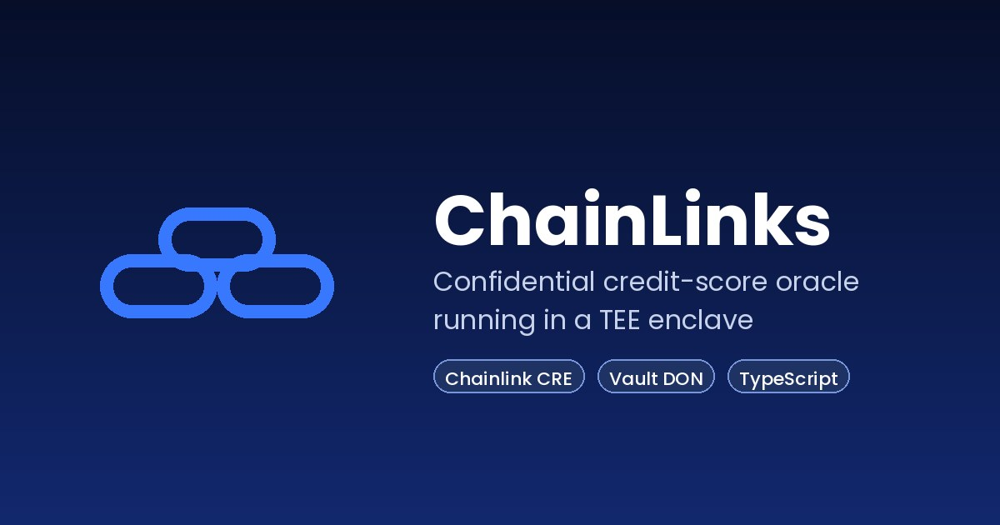</a> 
<b><a href="https://github.com/grahamaine/ChainLinks">ChainLinks</a></b> 
Chainlink CRE · TypeScript 
Confidential credit-score oracle running in a TEE enclave, plus Chainlink CRE building blocks. 
<a href="https://github.com/grahamaine/ChainLinks">💻 Code</a>
</td>
</tr>
<tr>
<td width="50%" valign="top">
<a href="https://github.com/grahamaine/habitual_trends">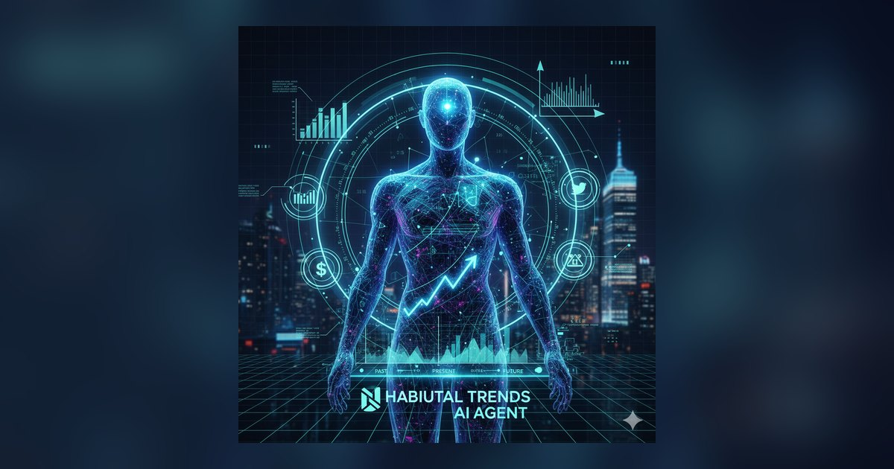</a> 
<b><a href="https://github.com/grahamaine/habitual_trends">Habitual Trends</a></b> 
Python · Reflex · Gemini 
AI health and habit tracker with Gemini-generated insights and coaching. 
<a href="https://github.com/grahamaine/habitual_trends">💻 Code</a>
</td>
<td width="50%"></td>
</tr>
</table>

---

## Brand kit

Official logos, favicons and credit snippets for every web portal, dApp and website **powered and rendered by thee AGENCY Consults (UG) Limited**.

| Folder | What's inside | Use it for |
|---|---|---|
| `logo/` | Full logo (1024/512), orange & mono marks, originals | Headers, about pages, docs |
| `favicon/` | `favicon.ico`, 16/32/48 px, Apple touch icon, Android 192/512, `site.webmanifest` | Copy into each site's `public/` folder |
| `avatar/` | GitHub / social profile pictures | GitHub → Settings → Profile picture |
| `social/` | GitHub social preview (1280×640), Open Graph card (1200×630) | Repo → Settings → Social preview; `og:image` |
| `badge/` | "Powered by thee AGENCY" SVG badge | Top of READMEs |
| `snippets/` | `head.html`, `footer.html`, `Footer.tsx`, `README-credit.md` | Copy-paste credit into any project |

**Colours:** Navy `#101437` · Orange `#FF5E1A` · White `#FFFFFF` · **Font:** Poppins

> Favicons use the wordless mark — the full wordmark is unreadable at 16–32 px.

© thee AGENCY Consults (UG) Limited · Entebbe, Uganda · Innovation Unleashed
