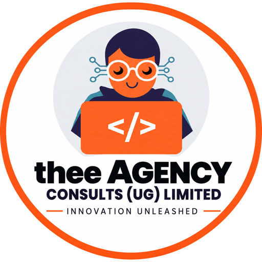

<h1 align="center">thee AGENCY — Brand Kit</h1>

Official logos, favicons and credit snippets for every web portal, dApp and website **powered and rendered by thee AGENCY Consults (UG) Limited**.

| Folder | What's inside | Use it for |
|---|---|---|
| `logo/` | Full logo (1024/512), orange & mono marks, originals | Headers, about pages, docs |
| `favicon/` | `favicon.ico`, 16/32/48 px, Apple touch icon, Android 192/512, `site.webmanifest` | Copy into each site's `public/` folder |
| `avatar/` | GitHub / social profile pictures | GitHub → Settings → Profile picture |
| `social/` | GitHub social preview (1280×640), Open Graph card (1200×630) | Repo → Settings → Social preview; `og:image` |
| `badge/` | "Powered by thee AGENCY" SVG badge | Top of READMEs |
| `snippets/` | `head.html`, `footer.html`, `Footer.tsx`, `README-credit.md` | Copy-paste credit into any project |

**Colours:** Navy `#101437` · Orange `#FF5E1A` · White `#FFFFFF` · **Font:** Poppins

> Favicons use the wordless mark — the full wordmark is unreadable at 16–32 px.

© thee AGENCY Consults (UG) Limited · Entebbe, Uganda · Innovation Unleashed
